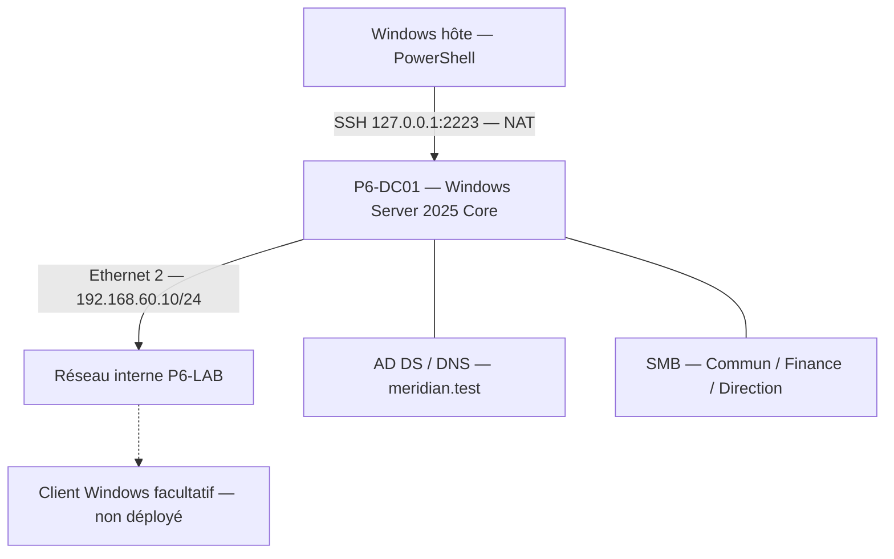

# Infrastructure technique — Meridian Bank

## Topologie

## Interfaces et services

| Interface | Mode VirtualBox | IP | Rôle |
|---|---|---|---|
| Ethernet | NAT | 10.0.2.15/24 | Administration SSH depuis l'hôte |
| Ethernet 2 | Réseau interne P6-LAB | 192.168.60.10/24 | Domaine et service DNS |

Le service DNS a été limité à l'écoute sur `192.168.60.10`. Les enregistrements A de la zone et le SRV `_ldap._tcp.dc._msdcs.meridian.test` ont été vérifiés. La stabilité des enregistrements après redémarrage reste à revalider.

## Organisation Active Directory

- OU : `Direction`, `Finance`, `IT`, `Utilisateurs`, `Serveurs`, `Groupes`.
- OU native `Domain Controllers` : ne pas supprimer.
- Utilisateurs fictifs : `s.martin`, `a.dupont`, `t.bernard`, `j.petit`, `a.dia`.
- Groupes : `GG_Direction`, `GG_Finance`, `GG_IT`, `GG_Employes`.

## Partages et contrôle d'accès

| Partage | Chemin local | Groupe métier (SMB Change / NTFS Modify) |
|---|---|---|
| Commun | `C:\MeridianData\Commun` | Utilisateurs du domaine |
| Finance | `C:\MeridianData\Finance` | GG_Finance |
| Direction | `C:\MeridianData\Direction` | GG_Direction |

Administrateurs et SYSTEM conservent les autorisations nécessaires. Les ACL trop larges héritées de BUILTIN\Utilisateurs sur Finance et Direction ont été supprimées et les ACL des fichiers vérifiées.

## Validation

- `Get-Service NTDS,DNS,Netlogon` : Running.
- `Resolve-DnsName` : `P6-DC01` et SRV LDAP résolus sur 192.168.60.10.
- Lecture `Finance/rapport_financier.txt` : refusée avec les identifiants `a.dia` ; réussie avec `a.dupont`.
- Les tests SMB depuis le contrôleur de domaine lui-même ne remplacent pas une validation depuis un client de domaine non privilégié.

## Points de vigilance

Le contrôleur de domaine héberge aussi les partages de fichiers uniquement pour satisfaire le socle à faibles ressources. Une architecture de production isolerait ces rôles. Ne pas ouvrir le port SSH redirigé au-delà de `127.0.0.1` de l'hôte. Ne pas conserver de secrets dans ce dépôt.
